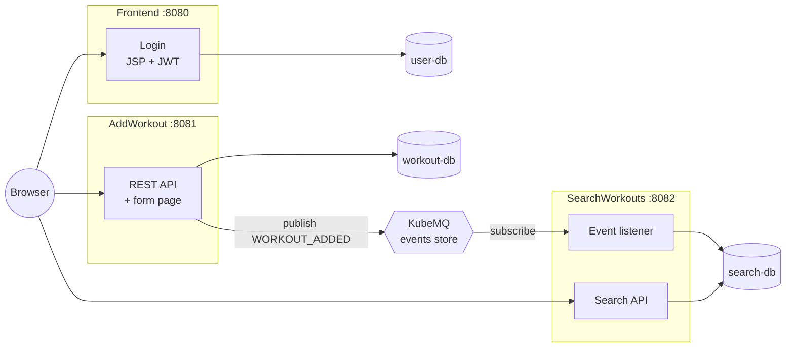
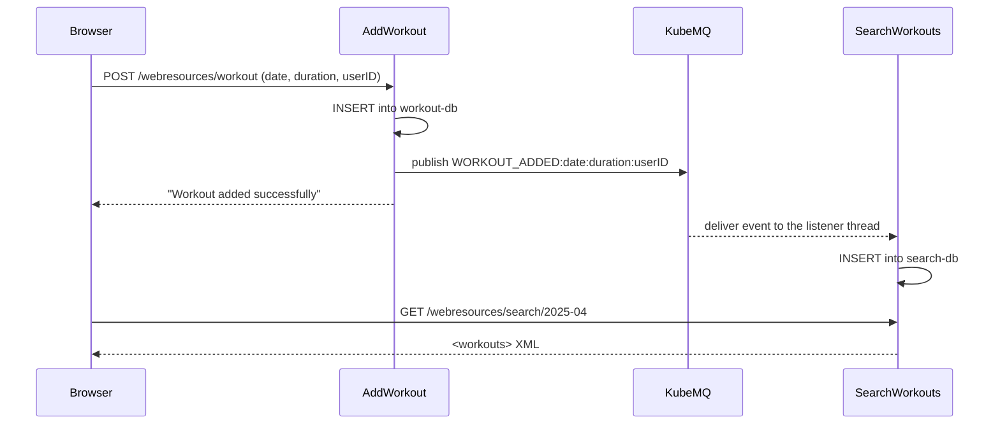

# Workout Tracker Microservices

An event-driven workout tracker split into three Java microservices: log a workout in one service and it shows up in another service's search, synced through a message broker.

**Tech Stack:** Java 11 · Java EE (Servlets, JSP, JAX-RS, JAXB) · MySQL 8 · KubeMQ · JWT · Docker Compose · Tomcat 9

## Features

- **Three independent services**, each with its own MySQL database (database per service).
- **Event-driven sync:** saving a workout publishes a `WORKOUT_ADDED` event; the search service consumes it and updates its own copy.
- **REST APIs with XML:** add and fetch workouts, and search them by date.
- **JWT login:** the frontend checks credentials and issues a signed token (1-hour expiry); protected pages redirect to login.
- **One-command local stack:** Docker Compose builds every service from source and starts it once its database and the broker are healthy.

## New to microservices?

- **Microservice:** a small app that does one job and runs, deploys, and stores data on its own.
- **Message broker (KubeMQ):** a post office for events. One service publishes a message to a channel; any service subscribed to that channel receives it.
- **Eventual consistency:** the search copy is updated a moment after the workout is saved, not in the same transaction.
- **JWT (JSON Web Token):** a signed token that proves a user has logged in.

## Architecture



Each service is a separate web app on its own Tomcat server and owns its database; no service reads another's tables. AddWorkout is the write side. SearchWorkouts keeps its own read copy, updated from events, so a search never calls the write service.

### How a workout flows



## Getting Started

**Prerequisites:** Docker with Compose v2. Java and Maven aren't needed locally, because the images build from source.

```bash
docker compose up -d --build
```

The first build downloads Maven dependencies. Then try the API:

```bash
curl -X POST -d "date=2025-04-10&duration=45&userID=1" http://localhost:8081/AddWorkoutService/webresources/workout
curl http://localhost:8082/SearchWorkoutService/webresources/search/2025-04
```

Or use the pages in a browser:

| Page | URL |
|---|---|
| Login (demo user `testuser` / `testpass`) | <http://localhost:8080/Frontend/> |
| Add a workout | <http://localhost:8081/AddWorkoutService/> |
| Search workouts | <http://localhost:8082/SearchWorkoutService/> |

Stop and remove everything with `docker compose down -v`. There are no automated tests yet.

## Technical Decisions & Challenges

- **Events instead of direct calls.** AddWorkout only publishes an event; it never calls or even knows about the search service, so the two can change independently.
- **Configuration from the environment.** Each service reads its database URL and credentials from environment variables (falling back to `config.properties`), so one image runs anywhere.
- **Startup order matters.** The search service subscribes to the broker once, at startup. Compose healthchecks make each service wait for its database and for KubeMQ.
- **Kubernetes and the broker.** The project originally targeted Kubernetes, but the free KubeMQ Community edition now refuses to run inside a cluster, so the supported setup is Docker Compose.

## Limitations

- The frontend's "Add Workout" and "Search Workout" pages aren't connected to the services yet; use each service's own page or the API.
- The JWT is issued at login but not checked by the other services, and its signing key changes on every restart.
- Demo user passwords are stored in plain text.
- Events published while the search service is down aren't replayed (it subscribes to new events only).
- Search matches dates as text; the exercise tables exist but nothing writes to them yet.
- Runs on a single machine with Docker Compose; no automated tests.

## Next Steps

- Connect the frontend pages to the services and validate the JWT in each service.
- Hash passwords (e.g. BCrypt) and load the JWT signing key from a secret.
- Resume from the last processed event after a restart, so no workouts are missed.
- Deploy to Kubernetes with a broker that supports it (e.g. RabbitMQ or NATS).
- Add integration tests with Testcontainers.

---

Built as a team project (2 members).

## License

[MIT](LICENSE)
